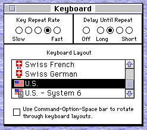

# Keyboard/mouse

## Keyboard

For non-ADB Macintosh models (128K, 512K, 512Ke and Plus), Snow emulates the
Apple M0110 keyboard with the following layout:

```  
,---------------------------------------------------------.
|  `|  1|  2|  3|  4|  5|  6|  7|  8|  9|  0|  -|  =|Backs|
|---------------------------------------------------------|
|Tab  |  Q|  W|  E|  R|  T|  Y|  U|  I|  O|  P|  [|  ]|  \|
|---------------------------------------------------------|
|CapsLo|  A|  S|  D|  F|  G|  H|  J|  K|  L|  ;|  '|Return|
|---------------------------------------------------------|
|Shift   |  Z|  X|  C|  V|  B|  N|  M|  ,|  .|  /|        |
`---------------------------------------------------------'
     |Opt|Mac |         Space               |Enter|Opt|    
     `------------------------------------------------'    
```

For Macintosh models with ADB, Snow emulates the Apple extended keyboard
M0115 with the following "U.S. Domestic" layout:

```
,---.   .---------------. ,---------------. ,---------------. ,-----------.             ,---.
|Esc|   |F1 |F2 |F3 |F4 | |F5 |F6 |F7 |F8 | |F9 |F10|F11|F12| |PrS|ScL|Pau|             |Pwr|
`---'   `---------------' `---------------' `---------------' `-----------'             `---'
,-----------------------------------------------------------. ,-----------. ,---------------.
|  `|  1|  2|  3|  4|  5|  6|  7|  8|  9|  0|  -|  =|Backspa| |Ins|Hom|PgU| |NmL|  =|  /|  *|
|-----------------------------------------------------------| |-----------| |---------------|
|Tab  |  Q|  W|  E|  R|  T|  Y|  U|  I|  O|  P|  [|  ]|  \  | |Del|End|PgD| |  7|  8|  9|  -|
|-----------------------------------------------------------| `-----------' |---------------|
|CapsLo|  A|  S|  D|  F|  G|  H|  J|  K|  L|  ;|  '|  Return|               |  4|  5|  6|  +|
|-----------------------------------------------------------|     ,---.     |---------------|
|Shift   |  Z|  X|  C|  V|  B|  N|  M|  ,|  ,|  /|Shift     |     |Up |     |  1|  2|  3|   |
|-----------------------------------------------------------| ,-----------. |-----------|Ent|
|Ctrl |Opt | Cmd |        Space            | Cmd |Opt |Ctrl | |Lef|Dow|Rig| |      0|  .|   |
`-----------------------------------------------------------' `-----------' `---------------'
```

These are currently the only keyboard layouts supported. If you experience
issues with incorrect key presses inside the emulated system, particularly with
localized operating systems, change the keyboard layout to "U.S." or "U.S. Domestic"
(Apple menu > Control Panel > Keyboard).



### Command key

To use the Command key on a MacOS host, you can simply use the Command
button on the host system.

On Windows and Linux hosts, you can use the right ALT key. The 'Super' key
(the Windows key) is also mapped to the Command key, but this key is often
not forwarded by the operating system. On Windows, you can use SHIFT+WIN to
press the Command key, but since this is rather inconvenient, Snow provides
the right ALT or CTRL as an alternative.

To enable or disable mapping an alternate key for Command, use the menu item
'Options > Input > Map alternate Cmd key'. This option persists globally.

### Power key

The Power key of the Apple Desktop Bus keyboards (the triangle key) is on the
Menu key of PC keyboards. On the Macintosh LC with the Apple IIe Card,
Control-Power is the Apple IIe's Control-Reset.

## Mouse

Snow supports two ways of emulating the mouse, which can be chosen under
'Advanced' in the [Load ROM dialog](starting.md) or in the 'Machine ->
Mouse emulation' menu while the emulator is running.

### Absolute positioning (default)

Absolute mouse positioning to provide an intuitive way of using
the mouse. Moving the mouse cursor over the display of the emulated
system will move the mouse on the emulated system. When entering the edge of
display, the cursor will immediately jump to that location. The speed of
the mouse matches that of the host system.

To achieve this, Snow patches a couple of global variables in the memory of the
Mac. This makes this mode unsuited for certain games and non-original operating
systems and ROMs.

### Relative positioning / hardware mouse emulation

This mode emulates the Macintosh mouse on the lowest level, but since hardware
mice only signal relative movement to the computer, it only passes relative
movements to the emulated system. This may make it harder to control the mouse,
but it provides the most accurate emulation experience and works best with
some games (e.g. first person shooters) and non-original software.

Relative positioning mode works best when using Snow [fullscreen](fullscreen.md)
or by using mouse capture (see below).
When switching to fullscreen mode, Snow will automatically switch to relative
positioning mode and back to the original mode when leaving fullscreen. This
behavior can be enabled/disabled using the 'Options > Input > Use relative mouse
in fullscreen' menu option. This option persists globally.

#### Capturing the mouse

Because a hardware mouse only reports movement, the host cursor and the cursor
of the emulated system drift apart and the host cursor can wander off the
emulated display or even out of the window entirely. To prevent this, Snow
captures the mouse: the host cursor is confined to the Snow window and hidden
for as long as the emulated system has the mouse.

Click the emulated display to capture the mouse and **right-click to release it
again**. When mouse capture is enabled, mouse movements will only register
when the mouse is captured (after the display is clicked).

Mouse capturing can be enabled/disabled using the 'Options > Input > Capture
mouse (relative mode)' menu option and is enabled by default. This option
persists globally.

Note that absolute positioning mode never captures the mouse.

#### Mouse speed

The 'Options > Input > Relative mouse speed' slider scales the movement passed to
the emulated system, from 0.25x to 4x. This setting only affects
relative positioning mode and persists globally.

## Game controller

A game controller can drive the emulated mouse and keyboard. Open
'Options > Input > Gamepad'. The submenu shows the connected controller's
name, or 'No controller'. Snow follows one controller: the one that most
recently sent an event, or the first controller that is still connected if
that one is gone.

'Enable gamepad' is checked by default. Clear it to ignore the controller.
The checkbox, the stick mode, the speed, and the button rows are saved as
soon as you change them, and they persist globally (see [Settings file](#settings-file)).

The emulated machine has to be running. While a file dialog or another modal
is open, the controller does not move the pointer, click, or type. While a
text field in Snow has the keyboard, keys from the controller are released
and further key presses wait; the stick can still move the pointer. While
Snow is waiting for a key in this menu, or capturing an Apple IIe binding,
controller keys and the mouse button are withheld. The stick can still move
the pointer.

### Left stick and D-pad

The Gamepad menu has two stick modes.

**Mouse movement** is the default. The left stick moves the emulated pointer.
Up on the stick moves up the screen. How far you push scales the step: at
full deflection the pointer moves by the Speed value, in guest pixels, on
every poll (once per interface frame) for as long as the stick is held.
The Speed slider is shown only in this mode. It runs from 1 to 40 and
defaults to 12.

A stick axis whose absolute value is below the deadzone stays at centre.
The default deadzone is 0.10, on a scale of about 0 to 1, and the comparison
is strict (a value equal to the deadzone still moves). Motion past the
deadzone is not rescaled, so a stick just outside it moves slowly. The
deadzone is the `deadzone` field in the settings file. It is not on the menu.

**Arrow keys** uses the same left stick. Past the deadzone, a direction
presses the matching arrow key, through the same keyboard mapping as the
host arrow keys. Holding the direction does not repeat. Returning to centre
releases the key. Speed is ignored. A diagonal holds two arrow keys.

The D-pad does the same job as the left stick. On each axis, a D-pad
direction replaces the stick. In mouse movement that direction is full
deflection. Opposite D-pad directions cancel. If the pad reports the D-pad
as an axis rather than buttons, a deflection of 0.5 or more counts as that
direction, and a D-pad button wins over the axis.

The right stick axes are not read. Clicking a stick is a button
(LeftThumb and RightThumb below).

### Relative and absolute mouse

Mouse movement follows the current mouse emulation mode ('Machine > Mouse
emulation', or the mouse choice in the [Load ROM dialog](starting.md)).

* **Absolute positioning** (the usual default). The first stick or D-pad
  motion starts at the centre of the emulated display, then steps from the
  controller's own point. That point stays inside the display. It is
  independent of the host mouse cursor, so a later nudge continues from
  where the controller last left it.
* **Relative positioning.** The same step is sent as relative mouse motion.
  Gamepad speed is the gamepad Speed slider. The
  'Options > Input > Relative mouse speed' slider scales the host mouse in
  relative mode and leaves the controller step alone. With
  'Use relative mouse in fullscreen' enabled, fullscreen switches the
  machine to relative positioning, and the stick follows the mode that is
  current.
* **Disabled.** The stick, the D-pad, and a button bound to the mouse button
  do nothing. A button bound to a key still types.

The controller does not capture the host cursor. Mouse capture stays the
relative-mode option for the host mouse.

### Buttons

The menu lists ten buttons, by position. On an Xbox pad, South is A, East
is B, West is X, and North is Y. On a PlayStation pad, South is Cross, East
is Circle, West is Square, and North is Triangle. LeftTrigger and
RightTrigger are the shoulder buttons (LB/L1 and RB/R1). Select is
Back, View, or Share. Start is Start, Menu, or Options. LeftThumb and
RightThumb are clicking the left and right sticks.

Analog triggers (LT/RT, L2/R2), the guide button, and extra buttons some
pads call C or Z are outside this list. The D-pad is stick movement, not a
row in the list.

| Menu name | Default | Typical control |
| --- | --- | --- |
| South | Mouse button | Bottom face button (Xbox A, PlayStation Cross) |
| East | None | Right face button (Xbox B, PlayStation Circle) |
| West | None | Left face button (Xbox X, PlayStation Square) |
| North | None | Top face button (Xbox Y, PlayStation Triangle) |
| LeftTrigger | None | Left shoulder (LB, L1) |
| RightTrigger | None | Right shoulder (RB, R1) |
| Select | None | Back, View, or Share |
| Start | None | Start, Menu, or Options |
| LeftThumb | None | Left stick click |
| RightThumb | None | Right stick click |

Each row is None, Mouse button, or Key.

* **None** ignores that button.
* **Mouse button** is the emulated mouse button. Snow sends a press and a
  release, and a hold does not repeat. Several rows may share that one
  button. It stays down until every such row is released. A press in the
  same moment as a release keeps it down.
* **Key** sends a host key through the same mapping as the keyboard,
  including 'Options > Input > Map alternate Cmd key' for right Alt and
  right Ctrl. The key is down while the button is down. A host key Snow
  does not map is ignored.

To bind a key, click 'Set key' on that row, or the Key radio when that row
is not already a key, and press the host key. The row then shows the key
name, such as `KeyZ` or `Space`. Esc cancels and leaves the previous
action. Closing the Gamepad menu cancels. Changing Enable, the stick mode,
or a button action releases whatever the controller was holding.

Unplugging the controller releases the mouse button and any keys that
controller was holding, including arrow keys in arrow-key mode. The pointer
stays where it is.

### Settings file

The mapping is global. It is not stored in the workspace. Snow keeps it in
`settings.json`, under the `gamepad` key:

* Linux: `$XDG_CONFIG_HOME/snowemu/Snow/settings.json`, or
  `~/.config/snowemu/Snow/settings.json` when `XDG_CONFIG_HOME` is unset
* macOS: `~/Library/Application Support/snowemu/Snow/settings.json`
* Windows: `%APPDATA%\snowemu\Snow\settings.json`

```json
"gamepad": {
  "enabled": true,
  "stick_mode": "Mouse",
  "speed": 12.0,
  "deadzone": 0.1,
  "buttons": [
    ["South", "MouseButton"],
    ["East", "None"],
    ["West", "None"],
    ["North", "None"],
    ["LeftTrigger", "None"],
    ["RightTrigger", "None"],
    ["Select", "None"],
    ["Start", "None"],
    ["LeftThumb", "None"],
    ["RightThumb", "None"]
  ]
}
```

`stick_mode` is `Mouse` or `ArrowKeys`. `enabled` is a boolean and defaults
to true. `speed` is guest pixels per poll at full deflection (the menu
slider writes an integer from 1 to 40; the default is 12). `deadzone`
defaults to 0.10. `buttons` is the ten rows above, in that order. Each entry
is a button name and an action: `None`, `MouseButton`, or a key object such
as `{"Key": "Space"}`. Key names match the menu (`KeyA`, `Digit1`,
`ArrowLeft`, `ShiftLeft`, and the other host key codes Snow accepts).

The menu writes this file when you change the mapping, and those menu
changes apply immediately. Snow reads the file at startup, so an edit you
make in a text editor applies the next time Snow starts. If `gamepad` is
missing, Snow uses the defaults above. A valid `gamepad` object with one
field left out uses the default for that field. If the saved `gamepad` value
cannot be parsed, Snow logs a warning, uses the defaults, and keeps the rest
of `settings.json`.

### Apple IIe joystick

On a Macintosh LC with the Apple IIe Card, 'Machine > Apple IIe joystick
mapping...' binds the card's game port. That window can use the same
physical controller. It does not change the Macintosh mouse and keyboard
mapping on this page. The IIe card also has 'Machine > Apple IIe joystick
keys (Scroll Lock)' for keyboard control of that port.
