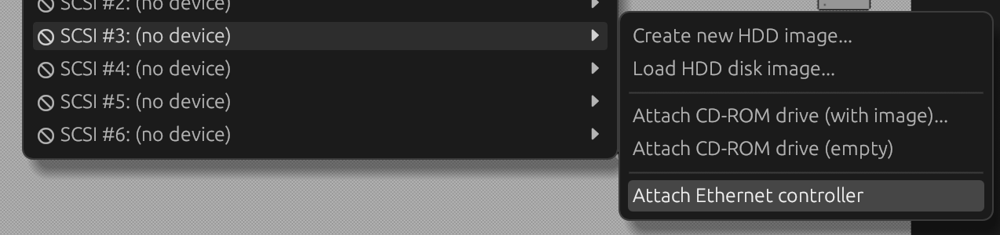
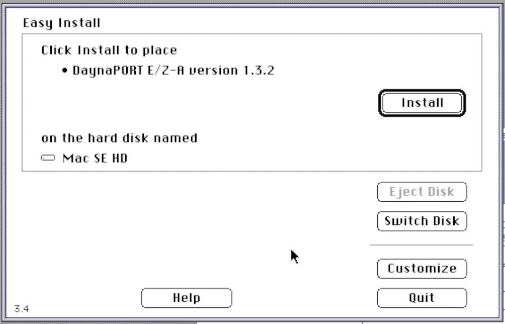
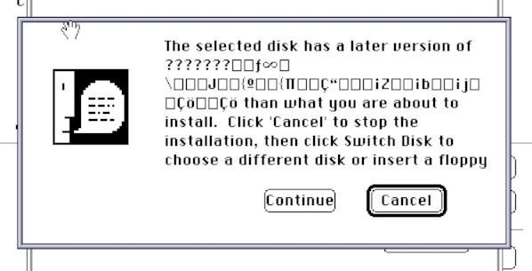
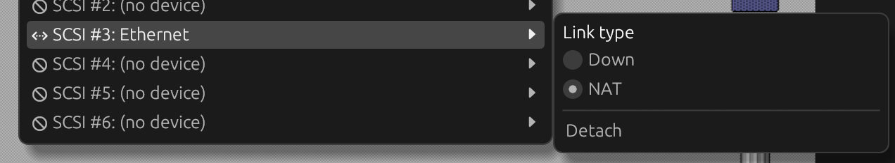
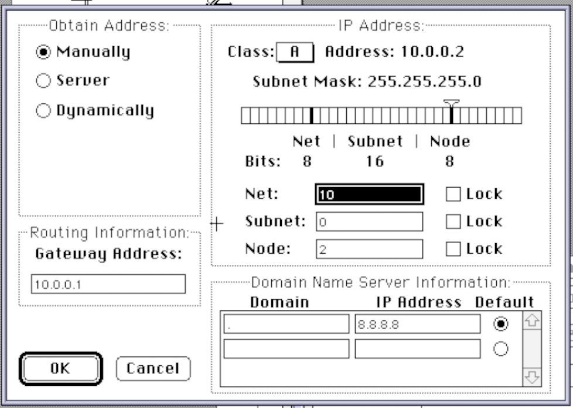
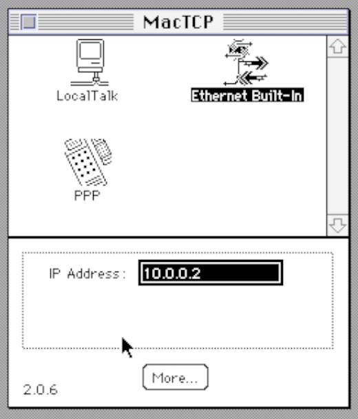
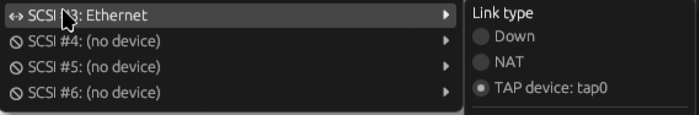
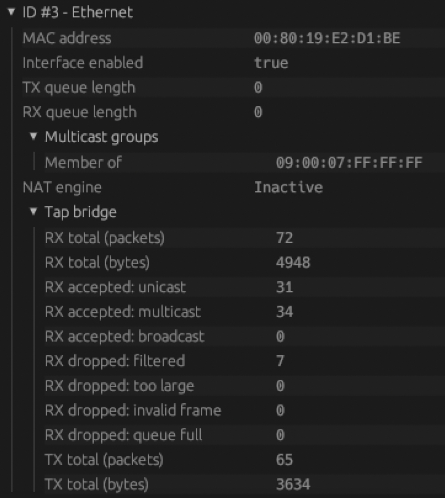

# Ethernet

Snow can emulate the DaynaPORT SCSI/Link Ethernet adapter which is an ethernet adapter with a SCSI interface. You
can use this adapter on any emulated Mac model that supports SCSI.

Snow also emulates the Ethernet controller some Macs have on their logic board, and Ethernet cards: see
[Built-in Ethernet](#built-in-ethernet) and [Ethernet cards](#ethernet-cards).

## Installation

To attach the emulated Ethernet adapter, use the 'Attach Ethernet adapter' option at any given SCSI ID in the menu:
'Devices' -> 'SCSI ID #_n_' -> 'Attach Ethernet adapter'.

<div class="warning">
Known issue: DaynaPORT drivers may not recognize the adapter. If you come across this, try to attach the Ethernet adapter
to SCSI ID 3 and your hard drive to ID 0.
</div>



Next, you will need to install the following in your emulated system:

* DaynaPORT drivers - the recommended (and tested) driver version is 7.5.3.
* MacTCP - 2.0.6 or higher is recommended.

### Installing DaynaPORT drivers

Use the Installer on the DaynaPORT driver disk. It will automatically select the correct driver for the adapter, which
is why you need to install the drivers _after_ attaching the Ethernet adapter (and rebooting).



During the installation, you may see the warning below. You can simply ignore this by clicking 'Continue'.



Once the drivers are installed, reboot.

### Installing MacTCP

To install MacTCP, simply drag the extension and control panel onto the System folder in your emulated system. Reboot
afterwards.

## Built-in Ethernet

The Quadra 700 and the Quadra 800 have Ethernet on their logic board, a National Semiconductor DP83932 SONIC, which
Snow emulates. It is always there: you don't attach it. It is in the menu as 'Devices' -> 'Built-in Ethernet', with
the same link choices as the DaynaPORT. The guest uses it as the Quadra's built-in Ethernet, with Apple's networking
software.

## Ethernet cards

An Ethernet card is chosen in the Load ROM dialog, with the emulated Mac, and stays in its slot as long as the
machine runs. It is in the 'Devices' menu under its name, with the same link choices as the DaynaPORT.

### Apple Ethernet NB Twisted-Pair Card

On the Macintosh II, IIx and IIcx and on the Quadras, a NuBus slot can hold an Apple Ethernet NB Twisted-Pair Card.
Choose it for a NuBus slot: it needs no ROM file. The emulated system needs Apple's driver for it, 'Apple Ethernet
NB', which the Network Software Installer installs.

### Apple Ethernet LC Card and LC Twisted-Pair Card

The PDS slot of the Macintosh LC, LC II, LC III and LC 475 can hold one of Apple's Ethernet LC cards, in place of
the Apple IIe Card: choose it under 'PDS Slot'.

* The Apple Ethernet LC Card needs the image of its ROM, 341-0470 or 341-0842, which holds its driver: browse for it
  in its ROM row.
* The Apple Ethernet LC Twisted-Pair Card needs no ROM file, but the emulated system needs Apple's driver for it:
  the System 7.5 installer has 'EtherTalk for Apple Ethernet LC cards' among its options.

### DaynaPORT E/si30

The PDS of the Macintosh SE/30 can hold a DaynaPORT E/si30: choose it under 'PDS Slot'. It needs no ROM file, but
the emulated system needs Dayna's driver for it, which the DaynaPORT installer installs.

## MAC address

An Ethernet adapter gets a random MAC address when it is attached. A [workspace](../workspaces.md) keeps
the address, so the emulated system has the same one every time the workspace is loaded, and the other
machines on the network see the same machine.

## Ethernet links

Snow currently supports a NAT-based ethernet link that runs in userland on the host system. This link only supports
TCP and UDP connections.

<div class="warning">
The NAT engine does not translate ICMP, which means you cannot ping through the NAT engine, even though TCP or UDP
connections to the same remote host may work.
</div>

You can select the Ethernet link type through the Devices menu: 'Devices' -> 'SCSI ID #_n_'.



### Configuring the emulated system for NAT

The NAT link emulates a gateway at IP-address 10.0.0.1. Your emulated system needs to have any IP-address in the
10.0.0.0/8 network. The addresses on this page are those of this network, the default.

Each adapter's menu has a 'NAT gateway' section: it shows the gateway's network and the DNS server it uses, and
'Settings...' changes them for the workspace. The network is the gateway's address and the length of the network's
prefix (8 for a class A network, mask 255.0.0.0; 16 for class B; 24 for class C); the dialog shows the addresses the
adapters get. 'Defaults' puts back 10.0.0.1/8 and the host's DNS server. Choose a network
that none of the host's own networks is part of. For example, if the host is on 10.1.1.0/24, the default network
holds it, and the emulated system can't reach the computers there: it takes them for its own network and looks for
them on it. A network such as 192.168.200.1/24 avoids that. The change takes effect at once: the adapters on a NAT link
move to the new network, and their connections drop.

With 'Save as default', the network is also the default, for the workspaces without a network of their own: new
ones, and those in which it was never changed, including those saved before Snow had this setting. Without a default,
they use 10.0.0.1/8.

The Ethernet adapters of a machine that are on a NAT link share the gateway: they are on one network and reach each
other.

The gateway keeps broadcasts and multicast on the emulated network. It doesn't let the emulated system reach the
host's own loopback addresses (127.0.0.0/8, and 0.0.0.0, which stands for the host itself): a connection to them is
refused. Services of the host can be reached at its address on its own network.

Snow includes a RARP server that provides the emulated system with a valid IP address, mask, and gateway. To use auto configuration, choose ` Server` to the `Obtain Address` section.

Snow also includes a DHCP and BOOTP server. It gives each Ethernet adapter of the emulated system an IP-address of
its own: 10.0.0.2 to the first one that asks, 10.0.0.3 to the next, and so on, and to an adapter always the same one,
also after a save state is restored. RARP gives the same addresses. It also gives the mask 255.0.0.0, and 10.0.0.1 as
router and DNS server. DNS queries sent to 10.0.0.1 go to a DNS server of the host, and the answers come back from
10.0.0.1. With Open Transport, choose 'Using DHCP Server' or 'Using BOOTP Server' in the TCP/IP control panel.

The DNS server is the one set in the NAT gateway's settings, or, with none set, the host's: on Linux and macOS, the
first one in `/etc/resolv.conf`; on Windows, the first one of the network adapter that the host's traffic goes out
through (the one connected, with a gateway and, of those, the lowest metric). The settings dialog shows the host's. On
macOS, `/etc/resolv.conf` holds the servers of the main network connection only: names that only a VPN's own DNS
server knows need that server set.

You can also configure the IP manually by following the mini guide below.

To set this up in MacTCP, open the MacTCP control panel, select 'Ethernet Built-In' and click the 'More' button to get
to the following screen:



In the 'Class' dropdown, select 'A'. Enter 10.0.0.1 as Gateway address in the bottom right input box. Enter DNS
information: 10.0.0.1 to use the DNS server of the host, or the DNS server of your choice. Then click 'OK'.



In this screen, enter the IP-address for the emulated system, which needs to be in the 10.0.0.0/8 network (for example:
10.0.0.2). Close the MacTCP control panel and reboot the emulated system. You should now be able to go online within
the emulated system.

### Stripping HTTPS connections

Snow can strip HTTPS and expose HTTPS-only sites to the emulated system in a transparent
fashion. To use this, select the 'NAT (HTTPS stripping)' link mode. Snow supports TLS 1.2 and higher.

This works transparently in the same way as the normal NAT mode. To visit a website, just
visit an http link (e.g. `http://www.spacejam.com/1996/`) for the https site you want to
visit.

When this mode is enabled, Snow will listen for connections the emulated system
establishes to TCP port 80 (http) and instead set up a TLS connection to that host on
port 443 and send the plaintext back and forth, basically doing TLS offloading in
a transparent fashion.

Snow waits for the first HTTP request to arrive before setting up
the TLS connection to retrieve the `Host:` header from the request to use in TLS Server
Name Indication (SNI). In the following plaintext stream, Snow will scan for `https://`
and rewrite that to ` http://` so hyperlinks follow the correct protocol from the
emulated system side.

<div class="warning">
By using this mode, you lose encryption for part of the network route. Be aware of the risks before you
submit any sensitive information over the internet from within the emulated system.
</div>

### Using tap interfaces (Linux only)

On Linux hosts, Snow can attach the virtual Ethernet adapter to a tap adapter, supporting all layer 2 and higher
protocols. This is a feature which allows advanced users to create more complex network setups and requires more
advanced networking and Linux knowledge. This also allows for the use of EtherTalk.

First, you need to create a tap interface that is owned by your user. For a tap interface to show up in Snow, the
interface name needs to start with either 'tap' or 'snow'. By making your user own the interface, you do not need to run
Snow as root for this to work.

For example, to create a tap interface owned by your current user:

```shell
sudo ip tuntap add dev tap0 mode tap user $UID
```

Then, you can select the tap interface in Snow through the menu: 'Devices' -> 'SCSI #_n_: Ethernet' -> 'TAP device:
tap_n_'.



For some examples of how to set up a network, see [Tap bridge network setups](../../guides/tapbridgesetups.md)

For troubleshooting and diagnostics of a tap-attached Ethernet adapter,
open ['View' -> 'Peripherals'](../debugging/peripherals.md)
and extend 'SCSI Controller', 'Targets', 'ID #_n_ - Ethernet'. This will show the interface status, MAC address of the
emulated adapter and some statistics on transmitted/received packets.


