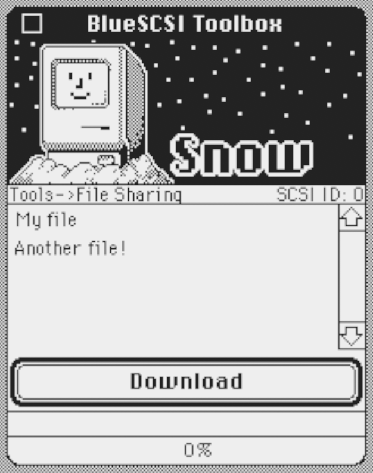

# File sharing

Snow supports the [BlueSCSI Toolbox](https://bluescsi.com/toolbox) protocol to easily share files with the emulated
system. This requires emulating a Macintosh model that has SCSI.

To get started, create a folder with files you'd like to share with the emulated system and place some files in there.
Then, in the Devices menu, pick a free SCSI ID and choose Attach BlueSCSI..., and select the folder. The BlueSCSI takes
that SCSI ID. You can attach several, each sharing its own folder.

Then, in the emulated system, start the 'BlueSCSI SD Transfer' tool. You can either download the latest version from
the [BlueSCSI Toolbox](https://bluescsi.com/toolbox) website, or choose the Tools -> Insert BlueSCSI Toolbox floppy
menu item, which will load a floppy with the tool on it. Note you must copy the tool from the floppy to another location
before you use it, otherwise you will see an error saying there is no space to download your file.

The BlueSCSI's own menu, under its SCSI ID in the Devices menu, lets you choose another folder or stop sharing. To remove
it, choose Detach.
